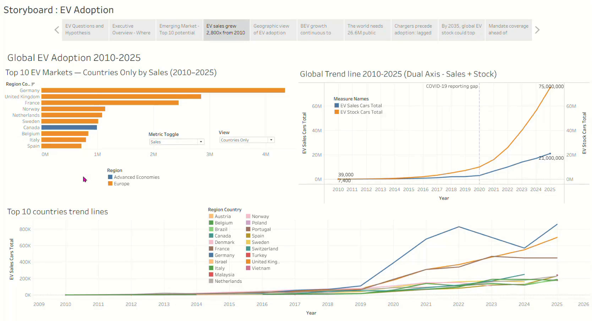
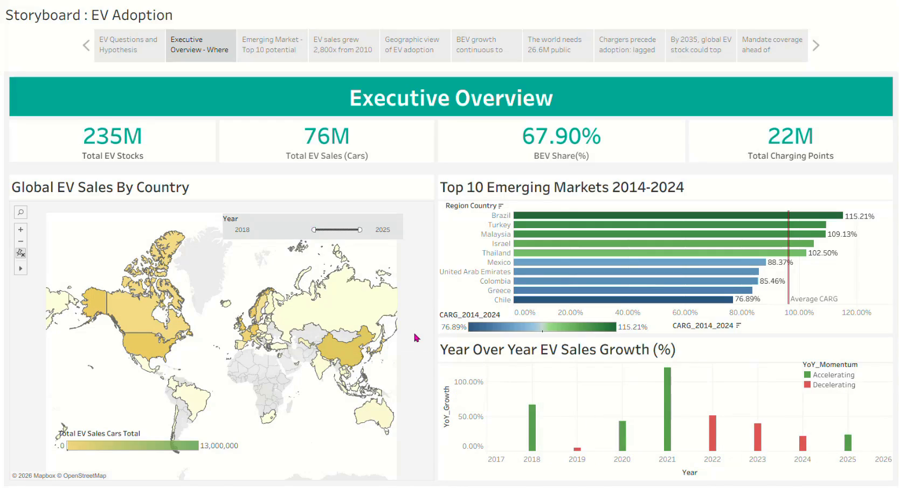
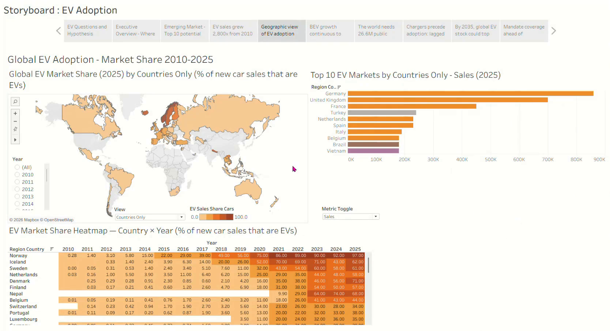
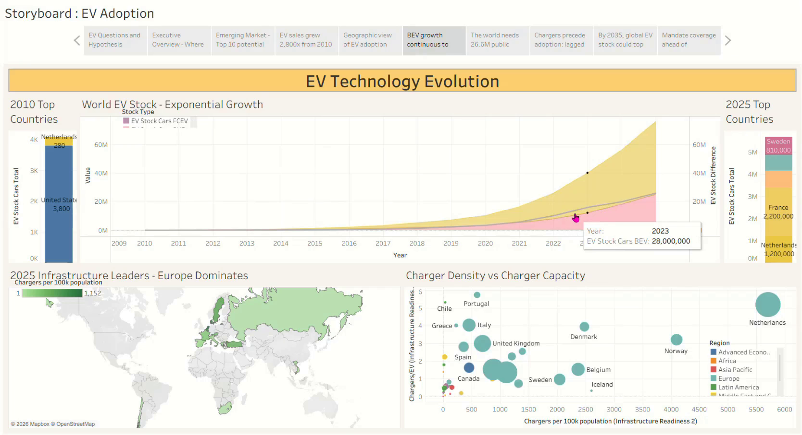
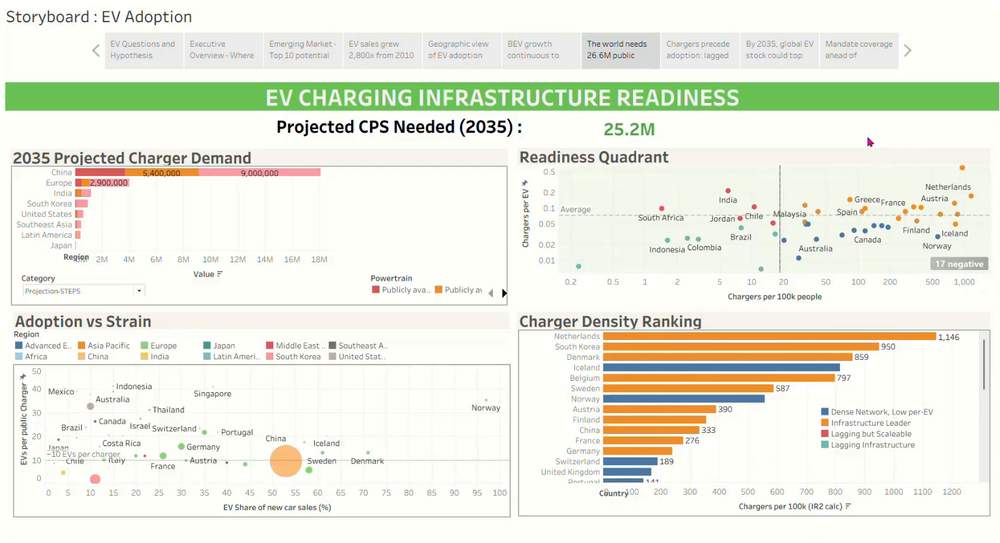
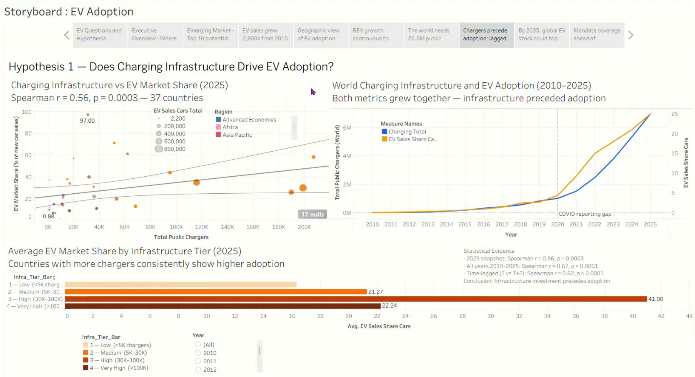
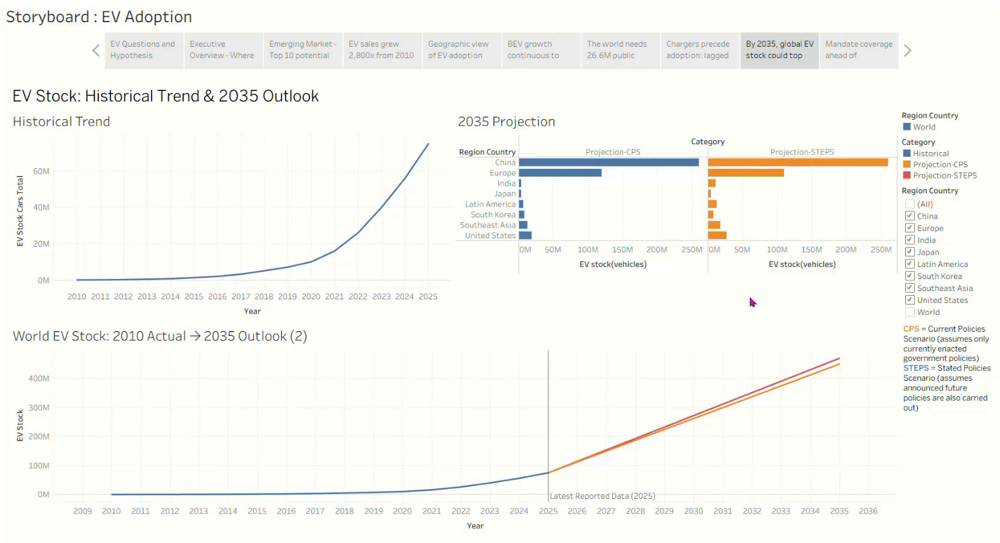
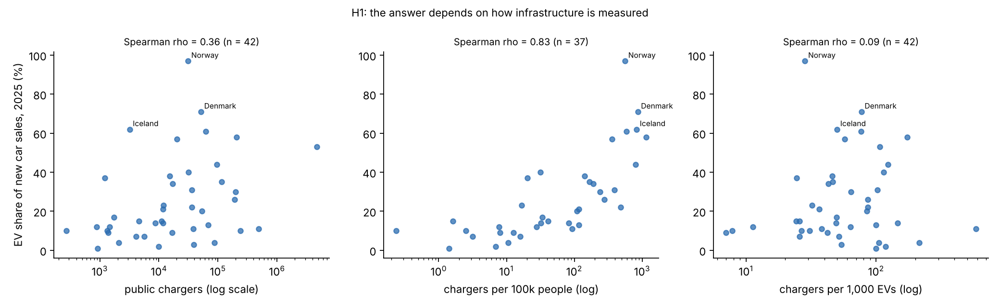

# Global EV Adoption 2010-2025: A Tableau Storyboard

An interactive **Tableau** story on how electric vehicles went from niche to mainstream, built on the
**IEA Global EV Outlook 2026** data (49,176 records covering 60 countries and markets plus regional aggregates, 2010-2025, with 2035 scenarios).
It answers four questions for policymakers, carmakers, charging providers and investors: who leads,
which technology is winning, whether charging infrastructure keeps pace, and where growth comes next.

Team project for a graduate data visualization course (UConn, summer 2026), five members.
Data preparation and hypothesis testing in **Python**, dashboards in **Tableau**.



## Key findings
| Question | Finding |
|---|---|
| How fast is the market growing? | World EV car sales grew from 7,400 (2010) to 21 million (2025); 1 in 4 new cars sold in 2025 was electric (0.012% in 2010) |
| Who leads? | China sold 45.9M EV cars over 2010-2025; among individual countries, Germany (4.3M), the UK (2.8M) and France (2.4M) lead, and 9 of the top 10 are European. Norway has the highest adoption: 97% of new cars in 2025 |
| Which technology wins? (H2) | Battery-electric cars: 66% of EV car sales and 67% of the EV car stock in 2025; plug-in hybrids recovered to 37% of sales by 2024, mostly in China; hydrogen fuel-cell cars never passed 0.4% |
| Is growth concentrated? (H3) | Yes: 5 markets captured 81.8% of EV stock growth 2020-2025 (China alone 62.3%; Gini 0.87). Market size, not penetration, drives growth: controlling for size, already-saturated markets grow less (partial rho -0.39, p = 0.012) |
| Does infrastructure drive adoption? (H1) | Countries with more public chargers adopt more (Spearman 0.56, 37 countries), but per EV they do not have more chargers (rho 0.09, n.s.). The data show an association, not a causal "build chargers and EVs follow" effect |
| Where next? | Fastest growth 2014-2024: Brazil (115% a year), Turkey, Malaysia, Israel, Thailand. By 2035 the world needs 25-27M public chargers (7M today); India's EV fleet is 3x larger if announced policies are implemented |

All numbers are recomputed from the data by `src/analysis.py` and listed in [`results/RESULTS.md`](results/RESULTS.md).

## Data
**Source:** International Energy Agency, *Global EV Outlook 2026* Data Explorer
([iea.org](https://www.iea.org/data-and-statistics/data-tools/global-ev-data-explorer)), licensed CC BY 4.0.
Yearly EV sales, stock, market share and public charging points by country/region, vehicle type (cars, vans,
buses, trucks, 2/3-wheelers) and powertrain (BEV, PHEV, FCEV), plus 2035 projections under two policy
scenarios. Values are rounded by the IEA to two significant figures. See [`data/README.md`](data/README.md).

## Approach

**Cleaning** (`notebooks/01_data_preparation_and_hypotheses.ipynb`, reproduced in `src/build_dataset.py`):
- 22,582 price rows had no unit: restored as "2025 USD"; 1,078 price rows had no geography: kept and labelled
  "Unattributed" rather than dropped.
- 15 exact duplicate rows removed, after confirming no key had two different values.
- Names standardised (USA, Korea, Turkiye, Viet Nam, Lao PDR) and each record flagged as an individual country
  or an IEA aggregate. China, the US, India, Japan and South Korea appear only as aggregates in the IEA data, so
  every chart offers a "countries only" and an "including major markets" view to avoid mixing the two.
- Charging points: years missing **between** a country's first and last report were added as empty values
  (14 country-charger-type years); years **before** a country started reporting were not invented.
- The 2020 dip in record counts is a reporting gap (fewer countries reported), not a fall in EVs.

**Reshaping:** the long table (one row per market, year, metric, vehicle type, powertrain) was pivoted into
the Tableau data source: `Master_Analytical` (928 market-years, sales/stock/share/chargers side by side),
`Master_Cars_Tech` (by powertrain), `Master_All_Modes` (by vehicle type) and `Master_Projection` (2035).
`src/build_dataset.py` rebuilds all four from the raw file and checks they match the dashboard data exactly.

**Derived metrics:** year-over-year growth and CAGR, global and regional market share, EVs per public charger,
chargers per 100k people, a two-axis infrastructure-readiness classification, and an adoption-momentum flag.

## Dashboards
The storyboard has 10 story points, each with interactive filters and parameters (region, year, metric toggle
between sales and stock, and a view toggle that adds the large IEA markets).

| Story point | What it shows |
|---|---|
| Executive overview | KPI cards, world map, year-over-year growth, top emerging markets by CAGR |
| Global adoption | top 10 markets by cumulative sales or stock, dual-axis global trend, country trend lines |
| Market share | filled map of EV share of new car sales, country-year heatmap |
| Technology evolution | BEV/PHEV/FCEV stock over time, leaders in 2010 vs 2025 |
| Infrastructure readiness | readiness quadrant, adoption vs strain bubble chart, charger density ranking |
| Hypothesis 1 | charging infrastructure vs EV market share, tiers of infrastructure |
| 2035 outlook | historical trend forking into the two IEA policy scenarios |
| Recommendations | four recommendations for policymakers and investors |

| | |
|---|---|
|  |  |
|  |  |
|  |  |

## Hypothesis results
| Hypothesis | Verdict | Evidence |
|---|---|---|
| H1: better charging infrastructure, higher adoption | **Partly supported** | Total chargers vs 2025 EV share: rho 0.56 (n = 37); chargers per 100k people: 0.83; chargers per EV: 0.09 (n.s.); year-on-year growth in chargers vs EV stock: Pearson 0.05. Association depends on how infrastructure is measured; causality is not shown |
| H2: BEVs are becoming dominant | **Supported** | BEV 62.8% of EV car sales in 2024 and 66.0% in 2025; BEV stock lead over all other EVs grew from 0.2M (2015) to 25.9M (2025) |
| H3: growth is concentrated in a few high-penetration markets | **Supported, refined** | Top 5 markets = 81.8% of 2020-2025 stock growth; the driver is market size (rho 0.88), and penetration conditional on size predicts *less* growth (saturation) |
| H4: emerging markets with low share but high potential | **Supported** | Brazil, Turkey, Malaysia, Israel, Thailand grew EV sales 100%+ a year (2014-2024) from small bases |



## My contributions
- Wrote the project proposal and obtained the IEA dataset.
- Reshaped the cleaned long-format data into the master analytical tables used by every dashboard.
- Exploratory analysis of the top countries by EV sales and stock and the global trend, 2010-2025.
- Built the **Global Adoption** dashboards (top-10 bar chart with metric and view toggles, dual-axis trend
  line, country trend lines, filled market-share map and country-year heatmap) and presented them.
- Tested Hypothesis 1 (charging infrastructure vs adoption) and summarised findings against the hypotheses.
- For this repository: rebuilt the data preparation as a single script that reproduces the dashboard data
  exactly, and recomputed every headline number and hypothesis test (`src/`).

Team: Anupama Rajendran, Farasha Yussof, Jacob Schmitt, Pooja Lakshmi, Vishal Reddy Bommineni.

## Run it
```bash
pip install -r requirements.txt
python src/build_dataset.py   # rebuild the Tableau data source from the raw IEA file and verify it
python src/analysis.py        # recompute findings -> results/RESULTS.md, results/figures/
```
The Tableau dashboards connect to `data/processed/EV_master_analytical.xlsx`.

## Repository
```
data/raw/            IEA Global EV Data Explorer 2026 (source file)
data/processed/      cleaned data and master analytical tables (the Tableau data source)
notebooks/           the team's data preparation, hypothesis testing and EDA notebooks (Google Colab)
src/                 build_dataset.py (reproducible preparation), analysis.py (findings and tests)
results/             RESULTS.md and figures generated by src/analysis.py
dashboards/          screenshots of the Tableau story points
docs/                project proposal
```

## Limitations
- IEA values are rounded to two significant figures; country values do not add up exactly to world totals.
- Five of the largest markets (China, US, India, Japan, South Korea) exist only as aggregates, so "countries
  only" rankings exclude them by construction.
- Reporting coverage grows over time (many countries start reporting after 2015), which can look like growth.
- Correlations across about 40 countries are descriptive; they do not establish that infrastructure causes
  adoption (chargers are also built because EVs are already there).
- Population figures used for per-capita metrics were added by the team and are not part of the IEA file.
